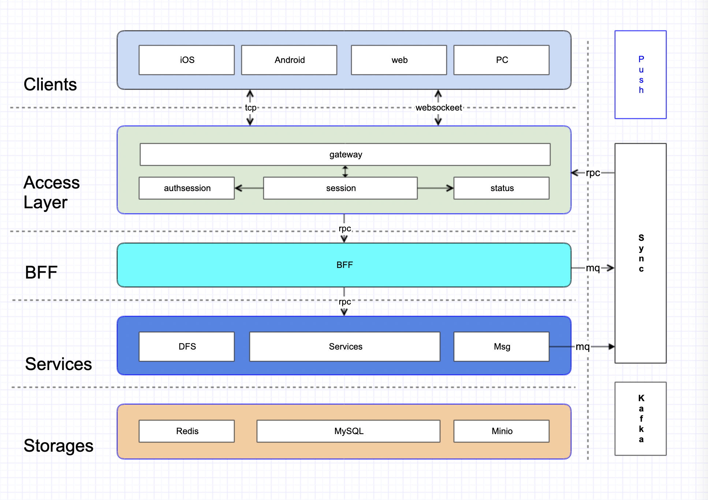

# Private Chat Server (Teamgram-based)

[中文](README-zh.md) | **English**

---

Unofficial open-source [MTProto](https://core.telegram.org/mtproto) server implementation in Go. Compatible with Telegram clients; supports self-hosted deployment.

This repository is based on [Teamgram Server](https://github.com/teamgram/teamgram-server). Teamgram contributors retain their original attribution under Apache-2.0. This project is not affiliated with Telegram or the Teamgram upstream maintainers.

> **Preview status:** this repository contains the server only. It does not include a first-party chat client or a production SMS verification provider. The default SMS verifier is disabled and rejects sign-in attempts; configure and review a real provider before enabling account login. Full client-to-server login, messaging, and upload tests have not been completed. Do not treat this preview as a production-ready private messaging service.

## Features

- **MTProto 2.0**
  - **Abridged**
  - **Intermediate**
  - **Padded intermediate**
  - **Full**
- **API Layer: 225**
- **Core features**
  - **private chat**
  - **basic group**
  - **contacts**

## Architecture



- [Architecture Docs](https://deepwiki.com/teamgram/teamgram-server) - `DeepWiki` teamgram/teamgram-server
- [Architecture (specs)](specs/architecture.md) — service topology, data flow, and ports  
- [Service topology and configuration](docs/service-topology.md) — ports, infrastructure dependencies, call graph, and Mermaid diagram ([中文](docs/service-topology-zh.md))

## Prerequisites

| Component | Purpose |
|-----------|---------|
| [MySQL](https://www.mysql.com/) 5.7+ / 8.0 | Primary data store |
| [Redis](https://redis.io/) | Cache, session, deduplication |
| [etcd](https://etcd.io/) | Service discovery & config |
| [Kafka](https://kafka.apache.org/) | Message & event pipeline |
| [MinIO](https://minio.io/) | Object storage |
| [FFmpeg](https://ffmpeg.org/) | Media transcoding (on server) |

Detailed versions and optional monitoring stack: [Dependencies and runtime (specs)](specs/dependencies-and-runtime.md).

---

## Manual installation

For running the server from source (Go build), follow the step-by-step guides:

- **[Manual installation (Linux)](docs/install-manual-linux.md)** — CentOS, Fedora, Ubuntu/Debian
- **[Manual installation (macOS)](docs/install-manual-macos.md)** — Intel and Apple Silicon

Requires Go 1.21+. You must install and configure dependencies (MySQL, Redis, etcd, Kafka, MinIO, FFmpeg), initialize the database and MinIO, then build and run.

---

## Docker installation

For running the full stack with Docker. **No manual data initialization:** the dependency stack initializes the database (via mounted SQL) and MinIO buckets (via `minio-mc`) on first start.

### 1. Clone

```bash
git clone https://github.com/shiyi-log/private-chat-server.git
cd private-chat-server
cp .env.example .env
# Set distinct random values for MYSQL_ROOT_PASSWORD, MYSQL_PASSWORD,
# MINIO_ROOT_PASSWORD, and GRAFANA_ADMIN_PASSWORD in .env.
# Run this command separately for each password.
openssl rand -hex 32
```

### 2. Start dependency stack

This starts MySQL, Redis, etcd, Kafka, MinIO (and optional monitoring). The database and MinIO buckets are initialized automatically.

```bash
docker compose -f docker-compose-env.yaml up -d
```

### 3. Start application

```bash
docker compose up -d
```

---

## Logging, monitoring & tracing

| Area | Brief | Detailed docs |
|------|--------|----------------|
| **Log** | [Filebeat](https://www.elastic.co/beats/filebeat) → Kafka (`teamgram-log`) → [go-stash](https://github.com/kevwan/go-stash) → Elasticsearch → Kibana. Config: `teamgramd/deploy/filebeat/conf/filebeat.yml`, `teamgramd/deploy/go-stash/etc/`. | [Log collection](docs/log-collection.md) ([中文](docs/log-collection-zh.md)) |
| **Monitor** | [Prometheus](https://prometheus.io/) scrapes metrics; [Grafana](https://grafana.com/) for dashboards. Enable via `Prometheus` block in `teamgramd/etc2/*.yaml`. Config: `teamgramd/deploy/prometheus/server/prometheus.yml`. | [Service monitoring](docs/service-monitoring.md) ([中文](docs/service-monitoring-zh.md)) |
| **Tracing** | go-zero [Jaeger](https://www.jaegertracing.io/) / Zipkin support. Set `Telemetry` in `teamgramd/etc2/*.yaml`. Jaeger is included in `docker-compose-env.yaml`. | [Link tracking](docs/link-tracking.md) ([中文](docs/link-tracking-zh.md)) |

---

## Compatible clients

No default sign-in code is shipped. The community build disables SMS verification by default and has no production SMS provider; authentication remains unavailable until a reviewed provider is configured.

| Platform | Repository | Patch Link |
|----------|------------|------------|
| Android | [https://github.com/teamgram/teamgram-android](https://github.com/teamgram/teamgram-android) | [teamgram-android](clients/teamgram-android.md) |
| iOS | [https://github.com/teamgram/teamgram-ios](https://github.com/teamgram/teamgram-ios) | [teamgram-ios](clients/teamgram-ios.md) |
| Desktop (TDesktop) | [https://github.com/teamgram/teamgram-tdesktop](https://github.com/teamgram/teamgram-tdesktop) | [teamgram-tdesktop](clients/teamgram-tdesktop.md) |

The table links upstream client projects and local patch notes, not ready-to-install binaries. The default Docker Compose setup binds only the client-facing gateway ports to `127.0.0.1`; internal RPC and observability ports are not published. For LAN access, set `TEAMGRAM_HOST_BIND_ADDRESS` in `.env` to the server's private interface address and restrict firewall access to the gateway ports only.

---

## Documentation

- [Project specs](specs/README.md) — Architecture, protocol, dependencies, contributing, security, roadmap
- [Service topology and configuration](docs/service-topology.md) — Ports, infrastructure, call graph ([中文](docs/service-topology-zh.md))
- [CONTRIBUTING](CONTRIBUTING.md) · [SECURITY](SECURITY.md) · [CHANGELOG](CHANGELOG.md)


---

## Community & feedback

- **Issues:** bugs and feature requests
- **Telegram:** [Teamgram group](https://t.me/+TjD5LZJ5XLRlCYLF)

---

## Enterprise edition

The following are available in the enterprise edition (contact the [author](https://t.me/benqi)):

- sticker/theme/chat_theme/wallpaper/reactions/secretchat/2fa/sms/push(apns/web/fcm)/web/scheduled/autodelete/... 
- channels/megagroups
- audio/video/group/conferenceCall
- bots
- miniapp

See [specs/roadmap.md](specs/roadmap.md) for community vs. enterprise scope.

---

## License

[Apache License 2.0](LICENSE).

---

## Give a Star! ⭐

If this project helps you, consider giving it a star.
